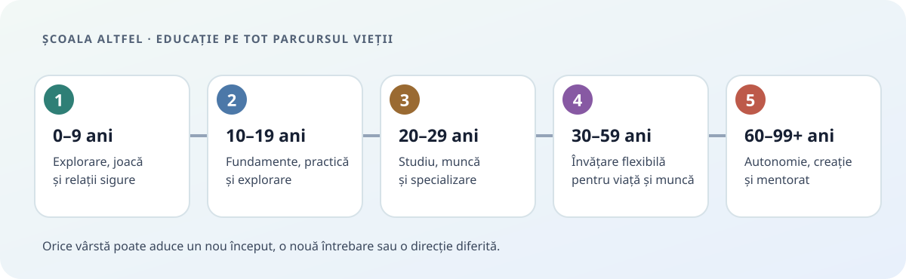
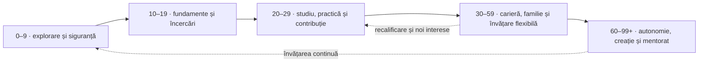
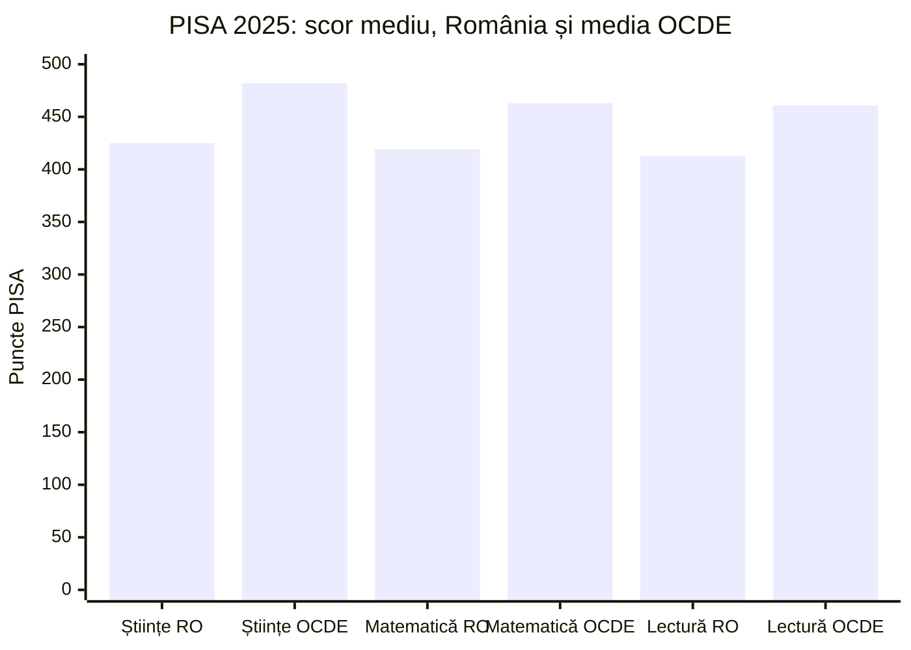
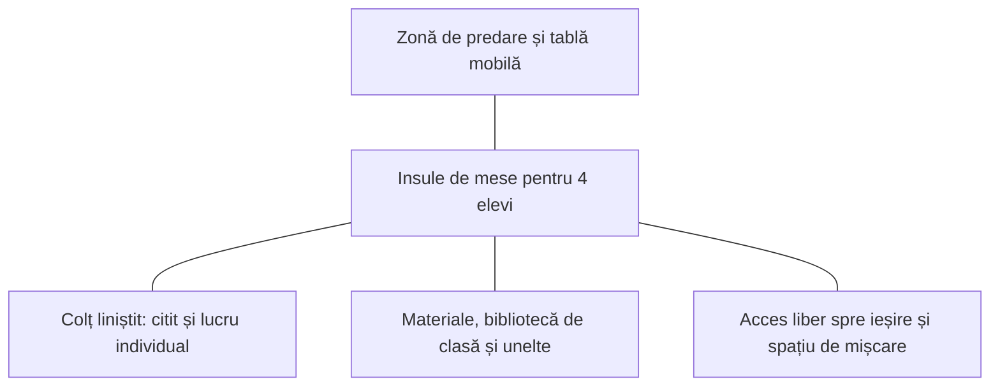

# Școala Altfel — o viziune pentru educație pe tot parcursul vieții

> **O educație care păstrează curiozitatea, oferă competențe pentru viață și îi ajută pe oameni să continue să învețe la orice vârstă.**

[Repository-ul GitHub al proiectului](https://github.com/Andrei-DanielDinu/scoalaAltfel)



Acesta este un proiect deschis de reflecție și colaborare. Nu este încă un curriculum validat și nici o propunere legislativă completă. Vreau să descriu ce aș schimba, să leg ideile de cercetare și de date, să recunosc ce nu știm încă și să invit oameni să îmbunătățească modelul.

**Versiune de lucru:** 2 noiembrie 2026. Datele, regulile și prețurile se schimbă; fiecare valoare are anul și sursa ei.

## Cuprins

- [Ideea centrală](#ideea-centrală)
- [Etapele vieții](#etapele-vieții)
- [Ce știm despre educația din România](#ce-știm-despre-educația-din-românia)
- [Principii de proiectare](#principii-de-proiectare)
- [Cum ar putea arăta o școală-pilot](#cum-ar-putea-arăta-o-școală-pilot)
- [Personal: un scenariu de planificare](#personal-un-scenariu-de-planificare)
- [Spații și mobilier](#spații-și-mobilier)
- [Materiale și costuri orientative](#materiale-și-costuri-orientative)
- [Evaluarea progresului](#evaluarea-progresului)
- [Ce trebuie testat](#ce-trebuie-testat)
- [Surse și lecturi](#surse-și-lecturi)

## Ideea centrală

Cred că educația începe înainte de școală și continuă după absolvire. Copiii au nevoie de un început sigur și curios; adolescenții au nevoie de fundamente și de ocazii să încerce lucruri reale; adulții au nevoie de învățare accesibilă printre celelalte responsabilități; iar oamenii în vârstă trebuie să poată învăța, crea și transmite mai departe.

Vreau o educație care să lege cunoașterea de viața reală. Matematica, limbile, științele, istoria, artele și filosofia nu dispar: sunt învățate atât direct, cât și prin proiecte, meserii, jocuri, călătorii și probleme concrete. Un proiect de grădină, de exemplu, poate folosi biologie, măsurători, buget, scriere și colaborare — dar elevii au nevoie și de explicații explicite și exerciții pentru a înțelege fiecare dintre aceste domenii.

Educația nu este o linie dreaptă cu o singură absolvire. Schema de mai jos descrie organizarea proiectului, nu vârste la care o persoană trebuie să încheie o etapă. Fiecare poate reveni, schimba direcția sau începe din nou.



## Etapele vieții

| Folder | Scopul educației în această etapă |
|---|---|
| [0–9 ani](etape/0-9/README.md) | Explorare prin joacă și relații sigure; limbaj, mișcare, primele competențe și o imagine largă a lumii. |
| [10–19 ani](etape/10-19/README.md) | Cunoștințe generale solide, proiecte aplicate, competențe cotidiene și explorarea mai multor domenii înaintea alegerii unei direcții. |
| [20–29 ani](etape/20-29/README.md) | Specializare flexibilă, studiu, muncă sprijinită și experiență practică; acces la trasee universitare, profesionale și mixte. |
| [30–59 ani](etape/30-59/README.md) | Învățare modulară, relevantă pentru muncă, familie, comunitate și interesele proprii. |
| [60–99+ ani](etape/60-99/README.md) | Învățare aleasă de persoană, sănătate și conexiune socială, creație și transmiterea experienței. |

Intervalele sunt orientative. Dezvoltarea nu urmează același calendar pentru toată lumea, iar „adult” sau „om în vârstă” nu descrie automat situația de muncă, sănătatea, autonomia ori obiectivele persoanei.

## Ce știm despre educația din România

Nemulțumirea mea față de sistem este o experiență și o judecată personală. Datele confirmă probleme importante, dar nu arată că fiecare școală eșuează în același fel sau că fiecare elev este demotivat. Pentru o dezbatere publică, e util să păstrăm împreună ambele lucruri: experiența oamenilor și măsurătorile disponibile.

| Indicator | Valoare și interpretare |
|---|---|
| Copii și elevi în preuniversitar | **2.868.800** în anul școlar 2024/2025, în ușoară scădere față de anul anterior. Raportul Ministerului precizează că unele rezultate de final de an pentru 2024/2025 nu erau încă disponibile la redactare. [Raportul Ministerului, 2024–2025](https://edu.ro/sites/default/files/_fi%C8%99iere/Minister/2025/div/Rapoarte_sistem/RAport_Stare_invatamant_preuniversitar_2024-2025.pdf) |
| PISA 2025, elevi de 15 ani | România: **425 științe, 419 matematică, 413 lectură**; mediile OCDE: **482, 463, 461**. România a avut și **442** la rezolvarea computațională a problemelor, domeniu nou în acest ciclu. PISA e un indicator populațional, nu nota unui elev sau o măsură completă a educației. [OECD — PISA 2025, România](https://www.oecd.org/en/publications/pisa-2025-results-volume-i-country-notes_2d4ff9ea-en/romania_2b6e8684-en.html) |
| Nivelul minim PISA | Au atins cel puțin nivelul 2: **48% la matematică, 52% la lectură și 54% la științe**; mediile OCDE au fost 65%, 69% și 74%. Prin urmare, aproximativ jumătate dintre adolescenții evaluați nu au atins pragul de bază PISA în fiecare domeniu. Acest semnal justifică sprijinul pentru competențe fundamentale, nu eliminarea matematicii sau lecturii din curriculum. [OECD — competențe PISA](https://www.oecd.org/en/publications/pisa-2025-results-volume-i-country-notes_2d4ff9ea-en/romania_2b6e8684-en.html) |
| Diferențe sociale | În PISA 2025, diferența de performanță la științe între sfertul cel mai avantajat și cel mai dezavantajat a fost **122 de puncte** în România, față de 85 în media OCDE. Statutul socio-economic a explicat 22% din variația rezultatelor la științe. [OECD — inegalități](https://www.oecd.org/en/publications/pisa-2025-results-volume-i-country-notes_2d4ff9ea-en/romania_2b6e8684-en.html) |
| Curiozitate și percepția școlii | **77%** dintre elevii români de 15 ani au spus că sunt curioși despre multe lucruri; **63%** că depun efort când munca devine dificilă; **22%** au fost de acord că școala a fost o pierdere de timp. Sunt răspunsuri auto-raportate, nu măsurători ale tuturor vârstelor. Ele arată că există curiozitate pe care școala o poate susține, alături de experiențe reale de neîncredere. [OECD — atitudini PISA](https://www.oecd.org/en/publications/pisa-2025-results-volume-i-country-notes_2d4ff9ea-en/romania_2b6e8684-en.html) |
| Părăsirea timpurie a educației | **15,5% în 2025** în România, cea mai ridicată pondere din UE în seria Eurostat raportată; media UE a fost 9,1%. Indicatorul se referă la tineri de 18–24 de ani care au cel mult studii gimnaziale și nu urmează educație sau formare. Pentru 2024, Eurostat raporta 16,8% în România și 9,4% în UE. [Eurostat — 2025](https://ec.europa.eu/eurostat/web/products-eurostat-news/w/ddn-20260604-1), [Eurostat — definiție și serie](https://ec.europa.eu/eurostat/statistics-explained/index.php?title=Early_leavers_from_education_and_training) |
| Diferențe de acces rural–urban | În datele din 2024, participarea copiilor de 3 ani la grădiniță era **57,9% în rural și 75,3% în urban**; părăsirea timpurie era **26,3% în mediul rural, 15,3% în orașe mici/suburbii și 3,3% în orașe**. Aceste disparități schimbă ce înseamnă „acces la școală” pentru familii. [Comisia Europeană — Education and Training Monitor 2025](https://op.europa.eu/webpub/eac/education-and-training-monitor/en/country-reports/romania.html) |
| Participarea la Evaluarea Națională VIII | Raportul Ministerului indică pentru 2025 o pondere de **83,2%** cu medii peste 5 și media generală **7,57**. Pentru 2024, valorile au fost 74,5% și 6,51. O medie la un examen nu este echivalentă cu stăpânirea tuturor competențelor. [Raportul Ministerului, tabelul EN VIII](https://edu.ro/sites/default/files/_fi%C8%99iere/Minister/2025/div/Rapoarte_sistem/RAport_Stare_invatamant_preuniversitar_2024-2025.pdf) |
| Participarea la Bacalaureat | În 2025, au promovat **77% dintre candidații prezenți**, la ambele sesiuni; rata pentru absolvenții promoției curente a fost peste 80%, față de aproximativ 40% pentru candidații din promoții anterioare. Numitorul este important: rezultatul nu reprezintă toți tinerii dintr-o generație. [Raportul Ministerului, 2024–2025](https://edu.ro/sites/default/files/_fi%C8%99iere/Minister/2025/div/Rapoarte_sistem/RAport_Stare_invatamant_preuniv-2024-2025.pdf) |
| Cadre didactice | În 2024/2025, raportul național agregat a fost **13 elevi/cadru didactic**, cu 18–19 în primar și 8 în gimnaziul rural. Acesta nu este numărul de elevi dintr-o clasă: agregă niveluri, localități și norme diferite. [Raportul Ministerului, secțiunea II.F](https://edu.ro/sites/default/files/_fi%C8%99iere/Minister/2025/div/Rapoarte_sistem/RAport_Stare_invatamant_preuniv-2024-2025.pdf) |
| Bani publici | Cheltuielile publice pentru educație au fost **3,0% din PIB în 2023**, cel mai mic nivel din UE în acea comparație; media UE a fost 4,7%. Acesta este un reper pentru planificarea resurselor, nu un preț direct al unei reforme. [Eurostat — finanțarea educației](https://ec.europa.eu/eurostat/en/web/products-eurostat-news/w/ddn-20260818-1) |
| Adulți care învață | În 2024, **8,9%** dintre adulții de 25–64 de ani au participat la educație/formare în fereastra măsurată de indicator; participarea rămâne printre cele mai scăzute din UE. [Raportul Ministerului, 2024–2025](https://edu.ro/sites/default/files/_fi%C8%99iere/Minister/2025/div/Rapoarte_sistem/RAport_Stare_invatamant_preuniv-2024-2025.pdf) |
| Climatul din sistem | Raportul Ministerului pentru 2024/2025 consemnează nemulțumiri și proteste sindicale în contextul măsurilor din Legea 141/2025. Relațiile de muncă și sprijinul profesorilor contează pentru fezabilitatea oricărei schimbări de curriculum. [Raportul Ministerului, introducere](https://edu.ro/sites/default/files/_fi%C8%99iere/Minister/2025/div/Rapoarte_sistem/RAport_Stare_invatamant_preuniv-2024-2025.pdf) |

PISA 2025 arată, de asemenea, că rezultatele la matematică și științe au fost în linii mari apropiate de 2022, iar la lectură au fost mai mici; față de 2015, ponderea elevilor sub nivelul 2 a crescut cu 12 puncte procentuale la matematică, 9 la lectură și 7 la științe. Rezultatul cere atenție la competențele de bază și la inegalități, dar nu demonstrează singur cauza lor. [OECD — comparații în timp](https://www.oecd.org/en/publications/pisa-2025-results-volume-i-country-notes_2d4ff9ea-en/romania_2b6e8684-en.html)



## Principii de proiectare

1. **Curiozitate înainte de conformare.** Elevii au alegeri reale, întrebări proprii și timp pentru a explora.
2. **Fundamente plus aplicare.** Citirea, scrierea, matematica, științele, istoria și limbile rămân vizibile. Sunt exersate și în contexte reale.
3. **Joaca, odihna și mișcarea fac parte din proiect.** Copiii au dreptul la odihnă și joacă; OMS recomandă copiilor și adolescenților, în medie, cel puțin 60 de minute zilnic de activitate fizică moderată sau viguroasă. Somnul recomandat diferă cu vârsta. O zi plină de activități nu trebuie să însemne o zi fără pauze. [UNICEF — Convenția privind drepturile copilului, art. 31](https://www.unicef.org/child-rights-convention/convention-text), [OMS — activitate fizică](https://www.who.int/initiatives/behealthy/physical-activity), [AASM — recomandări de somn pentru copii](https://jcsm.aasm.org/doi/10.5664/jcsm.5866)
4. **Fără stigmatizarea greșelii.** Erorile indică ce trebuie predat sau exersat mai departe. Standardele rămân clare; sprijinul și timpul de învățare se adaptează.
5. **Evaluare formativă, frecventă și utilă.** Profesorul observă ce știe elevul, oferă feedback și planifică următorul pas. Recuperarea are loc înainte ca lacunele să se acumuleze.
6. **Învățare activă și distribuită în timp.** Exersarea reamintirii, reluarea materiei după intervale și combinarea exemplelor explicate cu exerciții au sprijin în ghiduri de practică bazate pe cercetare. [What Works Clearinghouse — organizarea învățării](https://ies.ed.gov/ncee/wwc/PracticeGuide/1), [EEF — feedback](https://educationendowmentfoundation.org.uk/education-evidence/guidance-reports/feedback)
7. **Școala este comunitate, nu unica sursă de educație.** Familii, biblioteci, universități, ateliere, organizații și angajatori pot contribui, cu roluri și protecții bine definite.
8. **Acces echitabil.** Transport, masă, materiale, dizabilitate, limbă, ruralitate, sănătate și venit sunt parte din proiectarea sistemului, nu probleme lăsate fiecărei familii să rezolve singură.
9. **Învățarea adulților și a seniorilor este voluntară și flexibilă.** Nu presupunem că toată lumea va avea aceeași carieră, sănătate, familie sau vârstă de pensionare.

### Pauze, vacanțe și disponibilitatea campusului

Îmi imaginez un campus viu, cu activități la care oamenii pot reveni și cu programe de seară sau de vacanță pentru cei care le doresc. Asta nu trebuie să transforme prezența zilnică, permanentă, într-o obligație. Pentru copii păstrăm pauze zilnice, odihnă, joacă liberă, timp de familie și vacanțe. Articolul 31 din Convenția ONU recunoaște dreptul copilului la odihnă, timp liber, joacă, arte și viață culturală. Învățarea poate fi plăcută și totuși obositoare; somnul nu înlocuiește toate celelalte forme de recuperare.

În mod similar, ideea de a evita weekendurile sau vacanțele fără „valoare educativă” are nevoie de revizuire: odihna, joaca spontană și timpul ales de copil au valoare pentru dezvoltare, chiar dacă nu sunt conduse de un profesor. Un campus deschis este o facilitate; nu este un program școlar non-stop.

## Cum ar putea arăta o școală-pilot

### Scenariu de pornire

- **600 de elevi**, cu vârste între 6 și 18 ani; educația 0–5 și programele pentru adulți/seniori necesită spații, reguli și rapoarte de personal separate.
- **30 de grupe de bază a câte 20 de elevi.** Grupul de 20 este o ipoteză de proiectare pentru pilot, nu un prag demonstrat ca optim. Pentru activități practice sau sprijin individual, grupele se împart.
- **Zonare:** 30 de săli flexibile, 6–8 ateliere comune, 2 laboratoare de științe/tehnologie, bibliotecă, sală de arte și muzică, spații de sport și mișcare, bucătărie didactică, grădină, cabinet medical, spații liniștite/senzoriale și zone accesibile.
- **Orar:** module de concentrare alternate cu pauze, mișcare, masă, explorare liberă și proiecte. Pentru adolescenți, merită testat un început mai târziu al zilei, cu evaluarea transportului și a somnului.
- **Curriculum:** disciplinele au ținte explicite și timp de predare; proiectele reunesc disciplinele fără a le ascunde. Practici precum gătitul, grădinăritul, reparațiile, administrația, primul ajutor și bugetarea sunt module practice, cu personal calificat și reguli de siguranță.
- **Orientare profesională:** întâlniri cu profesioniști, perioade scurte de observare și proiecte reale, fără a transforma testele psihologice în predicții definitive despre „meseria potrivită”.

### Cum ar putea arăta o sală

Mobilierul se adaptează activității: mese ușoare, modulare, grupuri de patru pentru proiecte; aranjament în U pentru discuții; semicerc pentru prezentări; locuri individuale pentru citit sau lucru concentrat. Scaunele și mesele au înălțimi potrivite vârstei și pot fi reglate; există loc pentru scaun rulant, căi de circulație clare, dulapuri accesibile și panouri care reduc zgomotul. Nu există o singură formă de bancă potrivită pentru toate orele.



## Personal: un scenariu de planificare

Numerele de mai jos sunt **ipoteze pentru un pilot**, nu norme legale și nu o afirmație că fiecare școală trebuie să aibă aceeași organigramă. Necesarul depinde de vârste, dizabilități, program, transport, alimentație, limba de predare și dacă școala oferă servicii pentru copii mici.

| Roluri într-un campus cu 600 de elevi, 6–18 ani | Estimare de pornire |
|---|---:|
| Educatori/învățători/profesori pentru grupe și discipline | 40–48 FTE |
| Profesori de sprijin și specialiști în incluziune | 5–8 FTE |
| Psihologi școlari | 2 FTE |
| Consilieri educaționali și de carieră | 2 FTE |
| Personal medical | 1–2 FTE |
| Bibliotecă și coordonare de resurse | 1–2 FTE |
| Conducere, secretariat, contabilitate, IT și administrare | 4–6 FTE |
| Bucătărie, curățenie, mentenanță, pază și logistică | 10–14 FTE |
| Artiști, meșteșugari, sportivi și profesioniști invitați | 15–25 persoane cu fracțiune de normă / colaborări |

**Total de planificare:** aproximativ **63–82 FTE**, plus colaboratorii cu fracțiune de normă. Educatorii pentru grupa de vârstă 0–3 ani se calculează separat, în funcție de norme și cerințe de siguranță specifice.

Pentru un oraș cu **10.000 de elevi** înscriși în acest model, la 20 de elevi/grupă ar rezulta **500 de grupe**. Dacă rețeaua ar avea campusuri de aproximativ 600 de elevi, ar fi circa **17 campusuri**; aplicarea modelului de mai sus ar da în jur de **1.100–1.430 FTE** la nivelul rețelei, plus colaboratori. Este un ordin de mărime, nu o prognoză: localizarea școlilor, transportul, împărțirea pe vârste și specializările pot modifica substanțial totalul.

Pentru a ajusta numărul, se pornește de la formule, nu de la o singură normă:

```text
număr grupe = rotunjire în sus (elevi înscriși / mărimea aleasă a grupei)
FTE pentru predare = totalul orelor de predare cerute / orele de predare din norma unui FTE
cost anual personal = suma (FTE pe rol × costul anual complet pe rol)
```

Un psiholog sau consilier nu înlocuiește relația zilnică cu profesorul. Rolul său este să sprijine bunăstarea, accesul la servicii și deciziile informate, nu să eticheteze copiii sau să îi sorteze în trasee ireversibile.

## Spații și mobilier

| Pentru 600 de elevi | Cantitate de pornire |
|---|---:|
| Grupe de bază | 30 × 20 elevi |
| Mese și scaune reglabile | 600 locuri; model modular, cu variante accesibile |
| Spații comune de proiect | 6–8 ateliere |
| Laboratoare | 2 laboratoare flexibile de științe/tehnologie, cu stocare securizată |
| Bibliotecă și lectură | 1 bibliotecă centrală + colecții mici în clase |
| Artă și muzică | 2 spații multifuncționale, cu depozitare și materiale de protecție |
| Mișcare | sală, curte și trasee sigure pentru activitate zilnică |
| Sprijin individual | cabinet medical, 2 camere liniștite/senzoriale și săli pentru grupuri mici |
| Practică de viață | bucătărie didactică, atelier de reparații cu supraveghere, grădină |
| Dispozitive digitale | buget inițial: 1 dispozitiv la 2 elevi mai mari; pentru copiii mici, utilizare mai rară și ghidată |

În clasele de 20, mobilierul mobil permite schimbarea ușoară a aranjamentului. Tablele, ecranele și dispozitivele sunt unelte; selecția se face după activitatea de învățare, accesibilitate, durabilitate, reparații și protecția datelor.

## Materiale și costuri orientative

Prețurile comerciale sunt instantanee de piață consultate la **2 noiembrie 2026** și pot varia cu TVA, cantitate, licențe, transport și achiziție publică. Pentru bugetul final sunt necesare oferte scrise. Costurile nu includ clădire nouă, renovări structurale, transportul elevilor, masa zilnică, salariile sau întreținerea clădirii.

| Material / reper de preț | Cantitate pentru scenariul de 600 | Calcul orientativ |
|---|---:|---:|
| Set individual reglabil masă + scaun | 600 | Un comerciant afișa un set de bază la aproximativ **465 lei**; total de reper: **279.000 lei**. [Mobilier școlar — catalog](https://mobilier-scolar.ro/) |
| Laptop pentru activități ale elevilor mai mari | 300, raport 1:2 | Listările curente pentru laptopuri cu 16 GB RAM/512 GB SSD includ modele în jur de **2.600–3.200 lei**; reper la 2.600 lei: **780.000 lei**. [Altex — laptopuri 512 GB](https://altex.ro/laptopuri/cpl/filtru/capacitate-stocare-4561/512-gb/p/1/) |
| Laptopuri pentru personal | 40 | Reper la 2.600 lei: **104.000 lei**. Licențele, garanțiile și perifericele pot adăuga costuri. |
| Kituri STEM/robotică | 60, câte două pentru fiecare grupă | O categorie de kituri STEM afișa produse de la aproximativ **449 la 889 lei**; la un reper rotunjit de 650 lei: **39.000 lei**. [SmartRobot — kituri](https://smartrobot.ro/en/product-category/steam-kits/) |
| Colecție de lectură | 6.000 titluri, ipoteză de 10 titluri/elev | La un buget ipotetic de 60 lei/titlu: **360.000 lei**. Prețul se validează pe liste de achiziție și donații/licențe. |
| Materiale consumabile pentru artă, științe, grădină și proiecte | buget anual | Ipoteză de **300–800 lei/elev/an**: **180.000–480.000 lei/an**. |
| Rețea, depozitare, acustică, echipare accesibilă și spații liniștite | rezervă de planificare | Ipoteză inițială: **480.000–900.000 lei**; cere proiect tehnic și oferte locale. |

**Subtotal simplificat de echipare inițială:** circa **2,0–2,5 milioane lei** în scenariul de bază, în funcție de dispozitive, colecție și amenajări; un interval prudent de planificare ar fi **1,6–3,6 milioane lei**. Pe lângă acesta, bugetul anual pentru consumabile ar fi aproximativ **180.000–480.000 lei**. Sunt estimări de ordin de mărime, nu buget aprobat sau ofertă comercială.

Pentru o planificare inițială de **10.000 de elevi**, un cost de echipare de 1,6–3,6 milioane lei la fiecare 600 de locuri ar însemna aproximativ **27–60 milioane lei**, înainte de clădiri, salarii, masă, transport și costurile anuale. Acesta este un calcul de scalare, nu o cerere de finanțare.

## Evaluarea progresului

Evaluarea ar trebui să răspundă la întrebarea **„ce poate face acum persoana și care este următorul pas util?”**. Un portofoliu poate conține proiecte, texte, explicații orale, demonstrații practice, reflecții și probe scurte de reamintire după intervale. Elevul primește feedback concret și ocazii de a-și reface lucrarea.

- Nu comunicăm „ai picat ca persoană” sau „nu ești bun la domeniul acesta”.
- Facem vizibile obiectivele și criteriile, astfel încât elevul să poată înțelege progresul.
- Dacă o competență nu e încă stăpânită, oferim timp, explicație diferită, grup mic, mentorat sau sprijin individual și verificăm din nou.
- Folosim psihologi pentru sprijin specializat și wellbeing, cu roluri, confidențialitate și consimțământ clare. Profesorii nu fac diagnostice clinice.
- Păstrăm evaluări externe sau certificări atunci când sunt necesare pentru accesul la facultate și profesii reglementate; pregătirea pentru ele nu trebuie să devină singurul scop al școlii.
- Datele personale se colectează numai când ajută o decizie educațională concretă și se protejează conform legislației aplicabile.

## Ce trebuie testat

| Întrebare | Cum am putea afla |
|---|---|
| Proiectele interdisciplinare cresc înțelegerea fără să slăbească fundamentele? | Pilot cu evaluări înainte/după, probe de transfer și urmărire pe termen lung. |
| Ce mărime de grup sprijină relații bune și învățare? | Compararea grupurilor mici și mijlocii, luând în calcul nevoile de sprijin și costul per elev. |
| Câtă flexibilitate au nevoie adulții și seniorii? | Programe de seară, weekend și asincrone, cu participare voluntară și feedback. |
| Cum organizezi studiul universitar și munca pentru 20–29 de ani? | Testarea unor trasee cu practică plătită, fracțiuni de normă și acumulare modulară; durata de 10 ani nu este o regulă universală și trebuie justificată pentru fiecare calificare. |
| Ce face un campus accesibil și sigur? | Audit de accesibilitate, participarea elevilor și familiilor, protocoale de protecție și evaluare independentă. |
| Ce înseamnă progres, nu doar promovare? | Urmărirea competențelor de bază, autonomiei, stării de bine, participării, retenției și accesului echitabil, alături de examene. |

Propunerea de a păstra un program de lucru mai scurt pentru tinerii angajați poate fi explorată prin stagii și muncă part-time. Nu o transformăm într-un standard universal: orele de muncă, salarizarea, protecția tinerilor și acreditarea studiilor depind de legislație și de domeniul profesional.

## Surse și lecturi

### România: date și reformă

1. [Ministerul Educației — Raport privind starea învățământului preuniversitar, 2024–2025](https://edu.ro/sites/default/files/_fi%C8%99iere/Minister/2025/div/Rapoarte_sistem/RAport_Stare_invatamant_preuniversitar_2024-2025.pdf)
2. [OECD — PISA 2025 Results, country note România](https://www.oecd.org/en/publications/pisa-2025-results-volume-i-country-notes_2d4ff9ea-en/romania_2b6e8684-en.html)
3. [Ministerul Educației — comunicat și prezentare rezultate PISA 2025](https://www.edu.ro/press_rel_64_26_PISA_2025_rezultate_RO)
4. [Eurostat — părăsirea timpurie a educației, 2025](https://ec.europa.eu/eurostat/web/products-eurostat-news/w/ddn-20260604-1)
5. [Comisia Europeană — Education and Training Monitor 2025, România](https://op.europa.eu/webpub/eac/education-and-training-monitor/en/country-reports/romania.html)
6. [Eurostat — cheltuieli publice pentru educație, 2023](https://ec.europa.eu/eurostat/en/web/products-eurostat-news/w/ddn-20260818-1)
7. [OECD — Education and Skills in Romania, 2025](https://www.oecd.org/en/publications/education-and-skills-in-romania_594cbb5d-en.html)

### Practici educaționale și sănătate

8. [What Works Clearinghouse — Organizing Instruction and Study to Improve Student Learning](https://ies.ed.gov/ncee/wwc/PracticeGuide/1)
9. [Education Endowment Foundation — feedback](https://educationendowmentfoundation.org.uk/education-evidence/guidance-reports/feedback)
10. [Education Endowment Foundation — metacogniție și autoreglarea învățării](https://educationendowmentfoundation.org.uk/education-evidence/guidance-reports/metacognition)
11. [Convenția ONU privind drepturile copilului, text UNICEF — art. 31 și 32](https://www.unicef.org/child-rights-convention/convention-text)
12. [OMS — recomandări de activitate fizică pentru copii și adolescenți](https://www.who.int/initiatives/behealthy/physical-activity)
13. [American Academy of Sleep Medicine — consens privind durata somnului la copii](https://jcsm.aasm.org/doi/10.5664/jcsm.5866)
14. [OMS — recomandări pentru reducerea riscului de declin cognitiv și demență](https://www.who.int/publications/i/item/9789241550543)
15. [OMS — sănătatea mintală a persoanelor în vârstă](https://www.who.int/news-room/fact-sheets/detail/mental-health-of-older-adults/)

### Prețuri de referință, consultate la 2 noiembrie 2026

16. [Mobilier școlar — seturi individuale și mobilier modular](https://mobilier-scolar.ro/)
17. [Altex — laptopuri cu SSD de 512 GB](https://altex.ro/laptopuri/cpl/filtru/capacitate-stocare-4561/512-gb/p/1/)
18. [SmartRobot — kituri STEM](https://smartrobot.ro/en/product-category/steam-kits/)

---

**Cum poți contribui:** propune o sursă, semnalează o presupunere, rescrie o activitate pentru o vârstă concretă sau adaugă un proiect de materie într-un fișier nou. Păstrăm separat datele, experiențele personale și ipotezele de proiectare, ca să putem discuta ideile pe bune.
